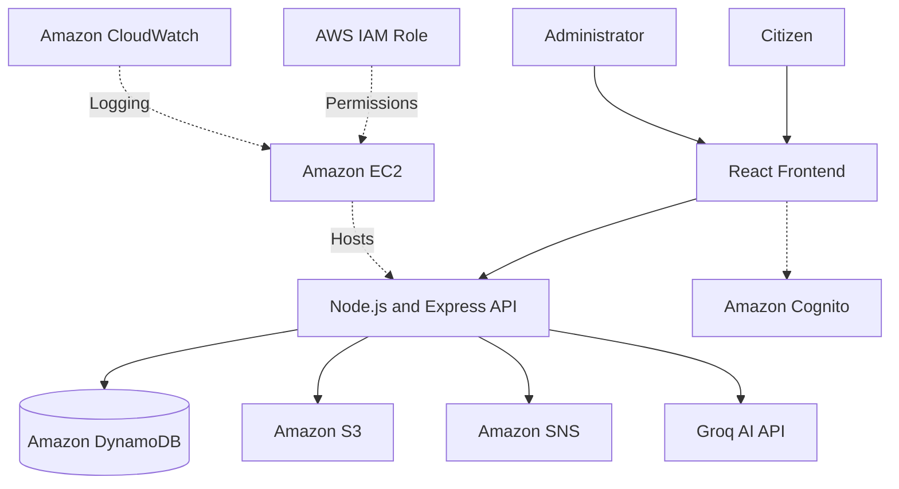

# Cloud-Based Disaster Reporting and Alert Management System

A cloud-based web application for reporting disaster incidents, managing incident reports, and sending alerts to relevant departments. The system combines AWS cloud services with AI-generated summaries to support incident review and response coordination.

Developed as a **Cloud Computing college project**.

## Features

### Citizen Portal
- Register and log in using Amazon Cognito.
- Submit incident reports with location, description, and optional photographs.
- View personal incident history and report details.
- View account status and incident-reporting risk information.

### Admin Dashboard
- Secure administrator login.
- View, search, and filter incident reports.
- Update incident status and delete reports.
- Review uploaded photographs and AI-generated summaries.
- Flag fake incidents and manage user accounts.

### AI-Powered Incident Processing
- Automatically assign incident priority using predefined rules.
- Route incidents to relevant departments.
- Generate incident summaries using the Groq API.
- Extract GPS metadata from uploaded photographs when available.
- Apply risk scores to users associated with reports flagged as fake.

### Cloud Integration
- Store incident records in Amazon DynamoDB.
- Store photographs in Amazon S3.
- Send departmental notifications through Amazon SNS.
- Use AWS IAM roles for backend access to AWS resources.
- Support application logging through structured JSON logs.

## Technology Stack

| Component | Technology |
|---|---|
| Frontend | React, Vite, Tailwind CSS |
| Backend | Node.js, Express.js |
| Authentication | Amazon Cognito and JWT |
| Database | Amazon DynamoDB |
| Image Storage | Amazon S3 |
| Notifications | Amazon SNS |
| AI Summarisation | Groq API |
| Hosting | Amazon EC2 |
| Monitoring | Amazon CloudWatch |

## System Architecture



## AWS Services

| Service | Purpose |
|---|---|
| Amazon Cognito | Citizen registration and authentication |
| Amazon EC2 | Hosts the backend application |
| Amazon DynamoDB | Stores incident reports and user profiles |
| Amazon S3 | Stores incident photographs privately |
| Amazon SNS | Sends alerts to configured departmental topics |
| AWS IAM | Controls permissions for AWS resources |
| Amazon CloudWatch | Supports logging and monitoring when configured |

The application also uses the Groq API for AI-generated incident summaries.

## Project Structure

```text
disaster-response-system/
├── frontend/
│   ├── src/
│   │   ├── components/
│   │   ├── context/
│   │   ├── pages/
│   │   └── services/
│   ├── .env.example
│   └── package.json
├── backend/
│   ├── src/
│   │   ├── config/
│   │   ├── controllers/
│   │   ├── middleware/
│   │   ├── routes/
│   │   ├── services/
│   │   ├── utils/
│   │   └── server.js
│   ├── .env.example
│   └── package.json
├── .gitignore
├── README.md
├── LICENSE
└── SECURITY.md
```

## Getting Started

### Prerequisites

- Node.js and npm
- Git
- An AWS account with the required resources and permissions
- A Groq API key
- Configured Amazon Cognito resources

### 1. Clone the Repository

```bash
git clone https://github.com/Genix2096/disaster-response-system.git
cd disaster-response-system
```

### 2. Configure the Backend

```bash
cd backend
npm install
```

Copy `.env.example` to `.env` and configure the required values.

On Windows:

```powershell
Copy-Item .env.example .env
```

On Linux or WSL:

```bash
cp .env.example .env
```

### 3. Configure the Frontend

Open another terminal:

```bash
cd frontend
npm install
```

Copy `frontend/.env.example` to `frontend/.env` and configure the API URL and required public Cognito settings.

For local development, the API URL will typically be:

```env
VITE_API_URL=http://localhost:5000
```

### 4. Start the Application

Start the backend using the development script configured in `backend/package.json`. If the script is `dev`:

```bash
npm run dev
```

Start the frontend in a separate terminal using the development script in `frontend/package.json`:

```bash
npm run dev
```

Open the local URL displayed by Vite in your terminal.

**Note:** The application requires valid AWS resources, permissions, Cognito configuration, and Groq configuration for the corresponding integrations to work.

## Environment Variables

The application uses environment variables to configure its services.

**Backend configuration may include:**
- `PORT`
- `NODE_ENV`
- `AWS_REGION`
- `S3_BUCKET_NAME`
- `DYNAMODB_TABLE_NAME`
- `DYNAMODB_USERS_TABLE_NAME`
- `COGNITO_REGION`
- `COGNITO_USER_POOL_ID`
- `COGNITO_CLIENT_ID`
- `SNS_TOPIC_ARN_FIRE`
- `SNS_TOPIC_ARN_POLICE`
- `GROQ_API_KEY`
- `GROQ_MODEL`
- `ADMIN_USERNAME`
- `ADMIN_PASSWORD`
- `JWT_SECRET`
- `FRONTEND_URL`

**Frontend configuration may include:**
- `VITE_API_URL`
- `VITE_COGNITO_REGION`
- `VITE_COGNITO_USER_POOL_ID`
- `VITE_COGNITO_CLIENT_ID`

Refer to the current `.env.example` files for the exact configuration required by your implementation.

Never commit real `.env` files, API keys, passwords, JWT secrets, or AWS credentials. Variables prefixed with `VITE_` are exposed to frontend code and must not contain secrets.

For local AWS access, use an appropriately permissioned AWS credential provider. For EC2, prefer an attached IAM role.

## Incident Priority Rules

The application uses predefined rules to assign incident priority.

| Incident Type | Priority |
|---|---|
| Fire | HIGH |
| Flood | HIGH |
| Accident | MEDIUM |
| Building Damage | MEDIUM |
| Road Damage | LOW |
| Other | LOW |

The system also routes reports to configured departments according to the application's rules.

These classifications are automated recommendations and do not constitute verified emergency assessments.

## Security

The project includes security mechanisms for authentication, access control, image storage, and request validation.

- Validate requests and uploaded files on the backend.
- Keep S3 image storage private and use temporary presigned URLs.
- Protect administrative endpoints with server-side authentication and authorisation.
- Use least-privilege IAM permissions.
- Keep API keys and other secrets out of source control.
- Restrict network access and configure HTTPS before public deployment.
- Avoid exposing sensitive incident details in application logs.

For vulnerability reporting guidance, see [SECURITY.md](SECURITY.md).

## Deployment

The intended deployment environment is Amazon EC2 running Windows Server.

The general deployment process is:

1. Configure the EC2 instance and attach the appropriate IAM role.
2. Install a supported Node.js runtime.
3. Configure the backend environment variables.
4. Install dependencies and start the backend.
5. Build the frontend for production.
6. Configure a web server or reverse proxy to serve the frontend and forward API requests.
7. Configure HTTPS and restrict inbound network access.
8. Verify authentication, database operations, image uploads, and notifications.

This is a deployment outline; the final hosting configuration must be verified before public access.

## Future Enhancements

Potential improvements include:

- Map-based incident visualisation.
- Real-time incident updates.
- Enhanced incident analytics.
- Additional administrative roles.
- Improved incident assignment and tracking.
- Expanded notification options.
- Automated testing and CI/CD.

## License

See the [LICENSE](LICENSE) file for the project's licensing terms.

---

**Project Repository:** [disaster-response-system](https://github.com/Genix2096/disaster-response-system)